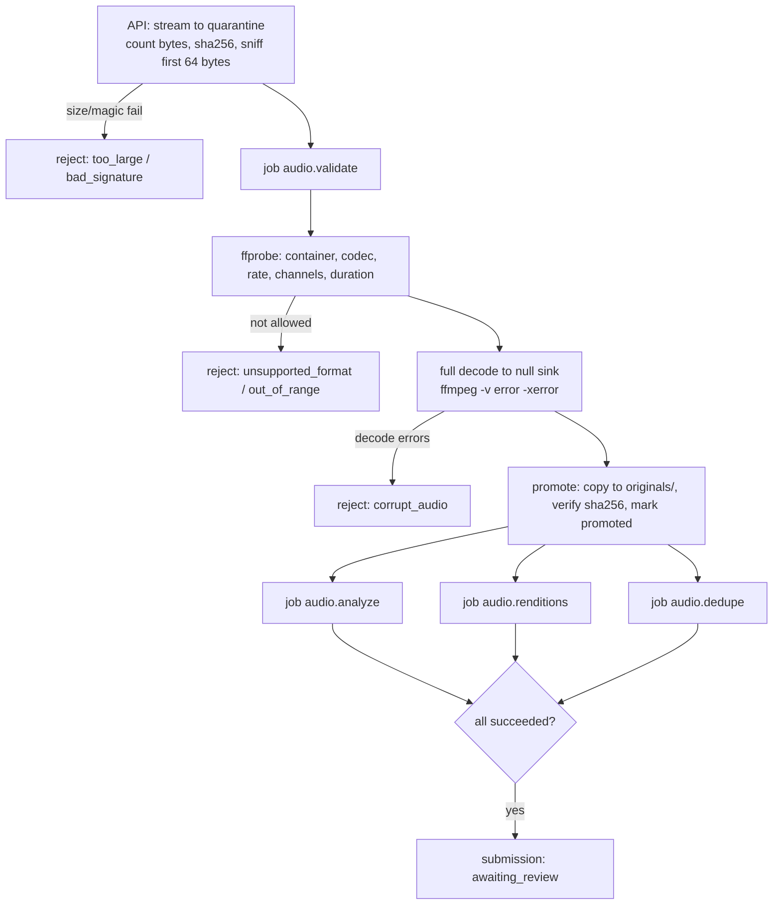

# Audio Processing Pipeline

Status: **Proposed.** Commands below were smoke-tested with FFmpeg 6.1 on synthetic audio during planning (2026-10-11); exact flags and thresholds must be re-validated in Milestone 4 against real device recordings (Q-T1).

## 0. Principles

1. **The original is sacred.** It is stored exactly as received after validation and never modified, overwritten, or deleted by processing (ADR-009).
2. **Deterministic first.** Validation, metadata, conversion, and metrics use FFmpeg/ffprobe with pinned versions. Model-based steps (VAD) are advisory and labelled as such.
3. **Everything is traceable.** Each derived file records source checksum, parameters, tool versions, and the `processing_runs` row that created it.
4. **Fail visibly.** Every failure has an error code the contributor or admin can understand; nothing is silently dropped.

## 1. Accepted inputs (initial)

| Container / codec | Typical source | Accept |
|-------------------|----------------|--------|
| WebM / Opus | Chrome/Android `MediaRecorder` | Yes |
| Ogg / Opus | WhatsApp-style voice notes, Firefox | Yes |
| MP4 (M4A) / AAC | iOS Safari `MediaRecorder`, phone recorder apps | Yes |
| Raw AAC in ADTS (`.aac`) | Android phone recorder apps (seen in the Q-T1 spike) | Yes |
| WAV / PCM (8–32-bit int, 32-bit float) | Field recorders | Yes |
| FLAC | Field recorders, archives | Yes |
| MP3 | Older recordings | Yes |
| 3GP / AMR-NB/WB | Older feature-phone recordings | **Evaluate** in M4 (decoder availability in the pinned FFmpeg build) |
| Anything else | — | Reject with `unsupported_format` |

Browser-reported MIME type and file extension are recorded for diagnostics only and **never trusted**.

## 2. Limits (initial values, configurable via environment)

| Limit | Value | Rationale |
|-------|-------|-----------|
| Max upload size | 100 MB | Covers ~10 min of 44.1 kHz stereo WAV or many hours of Opus; protects bandwidth and disk. |
| Max duration | 30 min | Long stories should be split; segmentation is future work. |
| Min duration | 1 s | Shorter is almost always accidental. |
| Max channels | 2 | Multi-track recordings out of scope. |
| Sample rate | 8 kHz – 96 kHz | Outside this, likely corrupt. |
| Uploads per user per hour | 60 | Abuse control; adjustable. |

Limits are enforced at three layers: Caddy (`request_body max_size`), API (streaming byte counter aborts early), worker (duration after decode).

## 3. Pipeline stages



### 3.1 Signature check (API, synchronous)

Read the first 64 bytes and match against an allow-list of magic numbers:

| Format | Signature |
|--------|-----------|
| WAV | `RIFF....WAVE` |
| FLAC | `fLaC` |
| Ogg | `OggS` |
| WebM/Matroska | `1A 45 DF A3` |
| MP4/M4A | `....ftyp` (bytes 4–7) with brand allow-list (`M4A `, `mp42`, `isom`, `iso5`, …) |
| MP3 | `ID3` or MPEG frame sync `FF Ex`/`FF Fx` |
| AAC (ADTS) | ADTS sync `FF F1` / `FF F9` (layer bits `00`); shares the MPEG sync pattern, so tell it apart from MP3 by the layer bits |
| 3GP/AMR | `....ftyp3gp` / `#!AMR` (if accepted) |

A signature match is necessary but not sufficient; the full decode in 3.3 is the real check.

### 3.2 Probe (worker)

```bash
ffprobe -v error -show_entries \
  format=format_name,duration,size,bit_rate:stream=codec_type,codec_name,sample_rate,channels,bits_per_sample,sample_fmt \
  -of json input
```

Reject if: no audio stream, more than one audio stream, any video stream with real frames (cover art in MP3/M4A is ignored), values outside §2.

### 3.3 Full decode integrity check

```bash
ffmpeg -v error -xerror -i input -map 0:a:0 -f null -
```

Any stderr output at `error` level → `corrupt_audio`. This also catches truncated uploads that probe correctly.

### 3.4 Promotion

Copy quarantine object → `originals/{yyyy}/{mm}/{recording_id}/original.{ext}`; re-hash the stored object; on match, set `upload_status = promoted` in the same transaction that inserts the `processing_runs` result. Object keys never contain names or client filenames.

### 3.5 Analysis (`audio.analyze`)

```bash
ffmpeg -hide_banner -nostats -i original -map 0:a:0 \
  -af "silencedetect=noise=-50dB:d=0.5,astats=metadata=0:measure_perchannel=none,ebur128=peak=true" \
  -f null -
```

Parsed into `recordings.quality_metrics`:

| Metric | Source | Flag rule (initial, tune in pilot) |
|--------|--------|-----------------------------------|
| `peak_dbfs` | astats Peak level | — |
| `rms_dbfs` | astats RMS level | `very_quiet` if < −45 dBFS |
| `integrated_lufs`, `true_peak_dbtp` | ebur128 summary | — |
| `clipping_ratio` | astats (samples at full scale / total) or peak ≥ −0.1 dBFS count | `clipping` if > 0.1 % |
| `silence_ratio` | silencedetect total silence / duration | `silent` if > 95 % |
| `speech_ratio_vad` | Silero VAD (optional, advisory) | shown only, no automatic flag in MVP |
| `duration_ms` | full decode (`ffmpeg -f null`), not the ffprobe header: browser WebM files have no duration (Q-T1) | `too_short` if < 1 s |

Flags are **advisory** signals for reviewers; they never auto-reject in the MVP (except `silent` + `too_short` which warn the contributor before upload where detectable client-side).

### 3.6 Renditions (`audio.renditions`)

| Rendition | Purpose | Command (core) | Approx. size |
|-----------|---------|----------------|--------------|
| `analysis_flac_16k_mono` | Standard working format for research/ML: 16 kHz, mono, 16-bit, lossless FLAC of the resampled signal | `ffmpeg -i original -map 0:a:0 -ac 1 -ar 16000 -sample_fmt s16 -c:a flac out.flac` | ~1–1.3 MB/min |
| `playback_opus` | Low-bandwidth streaming for reviewers/researchers | `ffmpeg -i original -map 0:a:0 -ac 1 -c:a libopus -b:a 24k -application voip out.webm` | ~0.2 MB/min |
| `waveform_peaks` | Lightweight JSON peaks for the review UI (no audio download needed to draw waveform) | computed from the analysis rendition | few KB |

Notes:

- Downmix to mono uses FFmpeg's default channel averaging; the original keeps both channels. If stereo recordings contain different speakers per channel (rare), reviewers flag it and channel-specific renditions are a future feature.
- **Lossy sources stay lossy.** Converting an Opus or MP3 original to FLAC does not restore quality; `is_lossy_source` is exported so researchers can filter.
- No loudness normalisation is applied to the analysis rendition (keeps signal comparable to the original). The playback rendition may apply `loudnorm` for listening comfort; this is recorded in `params`.
- Opus playback on iOS Safari must be verified (Q-T2); AAC-LC 48 kbit/s M4A is the fallback rendition.

### 3.7 Duplicate detection (`audio.dedupe`)

| Level | Method | Action |
|-------|--------|--------|
| Exact file | `sha256_original` equal | Flag `possible_duplicate`, link via `related_items`; tell contributor at upload time if the same user re-uploads. |
| Same audio, different container/encoding | `sha256_pcm`: SHA-256 of `ffmpeg -ac 1 -ar 16000 -f s16le` output | Flag. Valid only between recordings processed with the same FFmpeg version (recorded). |
| Near-duplicate (trimmed, re-recorded) | Chromaprint fingerprint — **experimental for speech** (Q-T5) | Flag only after evaluation shows acceptable precision. |

Duplicates are **never deleted automatically**; a reviewer decides.

### 3.8 Processing logs and failure recovery

- Each job attempt writes a `processing_runs` row: job type, target, attempt number, start/end, worker ID, tool versions (`ffmpeg -version` first line, Python package versions), input checksum, outcome, sanitised error.
- Retries: exponential backoff (e.g., 1 min, 5 min, 30 min); max 3 attempts for deterministic failures (decode errors don't retry — they reject), 5 for infrastructure failures (storage timeout).
- After max attempts: job `dead`, submission `processing_failed`, admin dashboard shows it. Re-queue is idempotent: renditions are keyed by `(recording_id, kind, params_hash)` and overwritten only in `derived/`, never in `originals/`.
- Worker crash mid-job: the job lock expires; the job is retried; partial derived files are written to a temp key and renamed only on success.
- Temporary files live in a per-job temp directory deleted in a `finally` block; the container has a size-limited tmpfs.

## 4. Client-side (browser) responsibilities

- Prefer `MediaRecorder` with `audio/webm;codecs=opus`, falling back to `audio/mp4` (Safari) via `MediaRecorder.isTypeSupported()`; record which was used.
- Show a live level meter and a "too quiet" hint; warn on recordings under 1 s.
- Save the recorded Blob to IndexedDB **before** upload starts.
- Do **not** transcode in the browser (battery, CPU on low-end phones, and loss of the true original).

## 5. Security notes

- FFmpeg parses untrusted input: run the worker as a non-root user in a container with no network access except to the database and object store, CPU/memory/time limits per job (`timeout` + cgroup limits), and keep FFmpeg patched.
- Never pass user-controlled strings into FFmpeg command lines; use argument arrays, never shell strings.
- Restrict FFmpeg protocols when reading local files (`-protocol_whitelist file`) so crafted playlists cannot fetch remote URLs.
