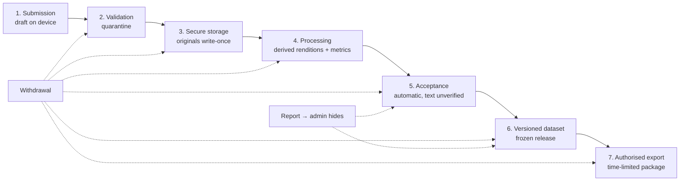

# Data Lifecycle

Status: **Proposed.** The lifecycle every contribution follows:

**Submission → Validation → Secure Storage → Processing → Acceptance → Versioned Dataset → Authorised Export**

with **Withdrawal** able to interrupt any stage, and an admin able to **hide** a reported item at any stage after acceptance. There is no human review stage: the professor decided on 2026-10-14 that nobody reviews submissions by hand ([ADR-021](ARCHITECTURE_DECISIONS.md#adr-021--no-human-reviewer-accept-after-automatic-checks-keep-text-unverified)).

## Stage-by-stage

| # | Stage | What happens | Where data lives | Who can see it | Exit criteria | Failure handling |
|---|-------|--------------|------------------|----------------|---------------|------------------|
| 1 | Submission | Contributor/facilitator creates draft; records or selects audio; enters text and metadata; attaches consent | Device (IndexedDB) until upload; then `submissions` row in `draft` | Creator only | Consent attached + required fields present → `uploading` | Draft persists on device; nothing on server is lost because nothing was sent |
| 2 | Validation | API streams file into `quarantine/`, checks size, magic bytes, SHA-256; worker probes and fully decodes; text checked for disallowed characters | `quarantine/` bucket/prefix; DB row `upload_status = quarantined` | Nobody except system | Valid → stage 3; invalid → `rejected_invalid` with reason | A decided upload's quarantine copy is deleted by `cleanup.quarantine`. The audio of a draft never submitted is deleted after 30 days by `cleanup.expire_drafts` (Q-T7); the app uploads it again from the phone when the draft is sent |
| 3 | Secure storage | Original copied to `originals/{yyyy}/{mm}/{recording_id}/original.{ext}`; checksum re-verified; DB updated in one transaction | `originals/` (versioned, write-once) | Admins; researchers via playback rendition only | Checksum matches | If copy fails, job retries; quarantine copy kept until success |
| 4 | Processing | Technical metadata, quality metrics, renditions, duplicate hashes; text NFC derivation | `derived/`; `processing_runs` | Contributor (own warnings), admins | All required jobs succeeded → `accepted` | Retries with backoff; after max attempts → `processing_failed`, admin re-queue |
| 5 | Acceptance | Status `accepted`; text keeps `verification_status = unverified`; effective access computed. A report from any user lets an admin hide the item with a restriction flag | DB: `submissions`, restriction flags, audit log | Per effective access | — | Hiding and un-hiding are audit-logged |
| 6 | Versioned dataset | Release draft → preview → data card → admin freeze; manifest with checksums stored | DB + `exports/manifests/` | Researchers with release access | Frozen | Freeze is transactional; failed manifest build leaves release in `draft` |
| 7 | Authorised export | Export request approved → worker builds package → signed, expiring download | `exports/` (auto-expire) | Requester only | Downloaded or expired | Failed build → `failed`, retry |

## Withdrawal at any stage

| Stage reached | Action |
|---------------|--------|
| 1 (device only) | Contributor deletes draft; nothing on server. |
| 2–5 | Submission → `withdrawn`; excluded from all views except admin; deletion of originals and derivatives scheduled per [DATA_RETENTION_AND_DELETION.md](DATA_RETENTION_AND_DELETION.md). |
| 6–7 | As above, plus `dataset_release_items.withdrawn_after_release_at` set, release annotated, future versions exclude it, export holders notified per data-use agreement (Q-G5). Already-distributed copies cannot be technically recalled; this limitation must be explained during consent. |

## Invariants (tested)

1. No row in `submissions` leaves `draft` without an active consent record allowing storage (the `allow_store_and_review` permission).
2. No file appears in `originals/` without a matching `recordings` row and checksum.
3. No release item references a submission whose effective access excludes the release purpose **at freeze time**.
4. No export package contains a field outside the export allow-list.
5. Every derived file references a `processing_runs` row with tool versions.
