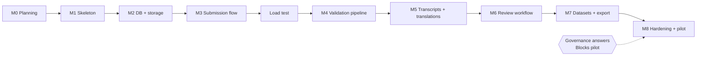

# Implementation Roadmap

Status: **Approved by Ayush Soni (project owner) on 2026-10-11.** M0, M1, and M2 complete (M2 on 2026-10-12); M3 in progress. The **Blocks pilot** questions must still be answered before any real data is collected.

## Approach

Build a **thin, secure vertical slice** first (one audio submission travels from browser → storage → review → approved), then widen. Each milestone ends with a working, tested system, not a pile of half-finished layers.

No calendar dates are given: pacing depends on team size and semester load (assumption A4). As a rough planning aid for 2–4 part-time students, most milestones are 1–3 weeks of work; treat that as a guess to be replaced by measured velocity after M1.

---

## M0 — Project planning and repository foundation *(done 2026-10-11)*

- **Deliverables:** all `docs/*.md`, `CLAUDE.md`, `.claude/` skills and rules, `.gitignore`, `.editorconfig`, `.env.example`, updated README, `docs/PLANNING_REVIEW.md`.
- **Dependencies:** none.
- **Acceptance criteria:** the project owner approves the plan (or requested changes are made); repository visibility and push route resolved (Q-P4); git author identity confirmed.
- **Tests:** document consistency review (see PLANNING_REVIEW); `.gitignore` verified with `git check-ignore`.
- **Before moving on:** explicit approval to start implementation.

## M1 — Application skeleton and development environment *(done 2026-10-11; device spike done for Android Chrome, iOS Safari still to test; see Q-T1 findings)*

- **Deliverables:** `backend/` (FastAPI app factory, config, health endpoints, worker entrypoint stub), `frontend/` (Vite React TS, router, i18n with `hi`/`en`, layout), `infra/docker-compose.yml` (PostgreSQL 18), GitHub Actions CI (lint, type-check, unit tests, forbidden-file check, secret scan), development commands added to `CLAUDE.md`.
- **Dependencies:** M0 approval.
- **Spikes:** (a) record on 2–3 real target phones with `MediaRecorder`, run ffprobe + full decode on the results (Q-T1) — recordings by team members of themselves only, deleted after the spike, never committed; (b) confirm library versions.
- **Acceptance criteria:** fresh clone → running API, worker, SPA, and DB locally by following README in < 1 hour; CI green; a commit adding a `.wav` file fails CI.
- **Tests:** health endpoint test; i18n key-completeness test; CI forbidden-file test case.
- **Before moving on:** spike findings recorded in `ASSUMPTIONS_AND_OPEN_QUESTIONS.md`.

## M2 — Database and secure file-storage foundation *(done 2026-10-12: migrations 0001–0007, auth, object storage, job queue; schema deviations recorded in ADR-019 and ADR-020)*

- **Deliverables:** Alembic migrations for identity, speakers, consent, submissions, recordings, renditions, text layers/revisions, review events, processing runs, audit events; append-only triggers and DB roles; `ObjectStore` interface with local and S3 adapters; job queue (Procrastinate spike vs. in-house, ADR-007; spike chose in-house, ADR-019); invite-only auth with sessions + CSRF; audit logging helper; seed script with synthetic users.
- **Dependencies:** M1.
- **Acceptance criteria:** login/logout works; role checks enforced; immutable tables reject UPDATE/DELETE as `app_rw`; storage adapter passes the same contract tests for local and S3-compatible backends; job enqueue → worker → `processing_runs` row.
- **Tests:** migration up/down/up; trigger tests; auth tests (rate limit, session revoke, CSRF); storage contract tests; audit event written for role change.
- **Before moving on:** schema reviewed against [DATABASE_SCHEMA.md](DATABASE_SCHEMA.md); deviations recorded as ADRs.

## M3 — Contributor submission workflow (vertical slice) *(in progress: APIs and the contributor screens done, with a Playwright test of the flow; still open: a real Android phone on a slow network, usability notes from 2 test users, and a Hindi speaker's review of the UI text)*

- **Deliverables:** speaker creation (self + facilitator); consent capture (in-app + oral recording evidence + paper reference) against a seeded **test** consent form; submission draft; recording-mode choice (free / prompted / read) with a seeded **test** prompt library and admin prompt management (see RECORDING_MODES.md); in-browser recording + file selection; IndexedDB drafts with retry; upload into quarantine; "my submissions" page; Hindi/English UI.
- **Dependencies:** M2; answers to Q-G2, Q-G4, Q-G7, Q-X1, Q-X5, Q-X6 (provisional answers acceptable for development), Q-P1 user sessions recommended.
- **Acceptance criteria:** on a throttled "Slow 3G" profile and a real Android phone, a user can record, lose connection, recover, and upload without losing audio; no submission leaves draft without consent; contributor bundle ≤ 250 KB compressed (or documented deviation).
- **Tests:** upload security suite (part), consent gating, idempotency, Playwright happy path with fake media stream.
- **Before moving on:** usability notes from at least 2 test users (team members acting as contributors is acceptable at this stage).

## Load test of the submission flow (after M3, requested by the owner on 2026-10-12) *(first run done 2026-10-12, see [LOAD_TESTING.md](LOAD_TESTING.md); the worker part waits for M4's audio handlers)*

- **Deliverables:** a [Locust](https://locust.io/) script in `backend/loadtest/` (development dependency only; it sends nothing outside the machine) that simulates about 50 contributors signing in, creating drafts, and uploading **synthetic, generated** audio; a reviewer browsing scenario is added once the M6 review queue exists. Results go in a short `docs/LOAD_TESTING.md`: requests per second, slowest responses, and the point where the worker queue falls behind.
- **Dependencies:** M3 (uploads into quarantine); synthetic accounts, which the script creates in its own `lokdhara_loadtest` database.
- **How it runs:** against the local Docker Compose stack with synthetic data only, never against staging or production with real data.
- **Acceptance criteria:** the script runs from a fresh clone with one command; results and the machine they ran on are recorded; any bottleneck found becomes an issue or an ADR before M8.

## M4 — Audio and text validation pipeline

- **Deliverables:** worker jobs `audio.validate`, `audio.analyze`, `audio.renditions`, `audio.dedupe`, `text.derive`, `cleanup.quarantine`; promotion to originals; quality flags; text safety validation, NFC, script detection; admin failed-jobs page with retry.
- **Dependencies:** M3.
- **Acceptance criteria:** all fixture formats processed; corrupt/disguised files rejected with codes; originals' checksums unchanged after processing; re-running jobs is idempotent; Opus playback verified on target browsers or AAC fallback added (Q-T2).
- **Tests:** full upload-security and audio suites in [TESTING_STRATEGY.md](TESTING_STRATEGY.md); text property tests; failure/retry tests.
- **Before moving on:** FFmpeg version pinned and recorded; thresholds documented.

## M5 — Transcription and translation management

- **Deliverables:** text layers (transcription, translation, standalone); revisions with provenance; optimistic concurrency; diff view; uncertainty markup parser; stale-translation indicator; multi-script input support (Devanagari, Latin, Nag Mundari if Q-X4 confirms) with font check (Q-T6).
- **Dependencies:** M4; Q-X3 conventions (provisional acceptable).
- **Acceptance criteria:** contributor and reviewer revisions are append-only and attributed; concurrent edit returns 409; a translation is marked stale when the source is revised.
- **Tests:** revision integrity, concurrency, markup parser, script detection on all supported scripts.

## M6 — Reviewer dashboard and approval workflow

- **Deliverables:** review queue with filters; playback via signed URLs; waveform; approve/reject/request-changes/restrict; verification of revisions; restriction flags including `culturally_restricted` scope; contributor notifications in-app; researcher catalogue search with effective-access filtering.
- **Dependencies:** M5; Q-G3 (restricted categories), Q-P3 (reviewers).
- **Acceptance criteria:** full permission matrix test passes for Python and SQL implementations; reviewer cannot act on own submission; every decision audited.
- **Tests:** table-driven permission suite; state-machine transition tests; Playwright reviewer flow.

## M7 — Dataset export, quality checks, and versioning

- **Deliverables:** draft/preview/freeze/retract releases; pre-freeze checks D1–D9; deterministic export builder with manifest, data card, checksums; export request/approval; withdrawal workflow end-to-end (restrict, release annotation, PATCH preview, deletion routine with `app_erasure` role).
- **Dependencies:** M6; Q-L5 licence and Q-G5 data-use agreement needed before any *external* release (internal releases can be tested with synthetic data).
- **Acceptance criteria:** rebuilding an export gives identical checksums; withdrawn item cannot appear in any new release; export contains only allow-listed fields.
- **Tests:** export snapshot test; withdrawal propagation tests; pre-freeze check tests.

## M8 — Testing, security review, deployment, and pilot collection

- **Deliverables:** staging + production deployment per [DEPLOYMENT.md](DEPLOYMENT.md); backups + restore drill; monitoring and digest; admin MFA; security review checklist; facilitator training material; final consent forms (approved by ethics committee) loaded; pilot plan.
- **Dependencies:** M7; **all Blocks pilot questions answered** (Q-L1, Q-L2, Q-L3, Q-L4, Q-L8, Q-P4), hosting decision (Q-L7, Q-P5).
- **Acceptance criteria:** security checklist complete; restore drill successful; pilot starts only with written approval from the supervising professor/institution.
- **Tests:** full suite + manual device tests + external check that buckets are not public.

---

## Post-MVP candidates (not scheduled)

Time-aligned segmentation; resumable uploads (tus or S3 multipart); Mundari UI translation; two-reviewer consensus; lexicon module; ASR/MT suggestion evaluation on a reviewed test set (ADR-014); public release site (after governance approval); offline-first PWA sync.

## Team capacity notes

- Keep work in progress small: at most one milestone active, with no more than ~3 open pull requests.
- Each milestone ends with a short demo to the supervisor and an update to `ASSUMPTIONS_AND_OPEN_QUESTIONS.md`.
