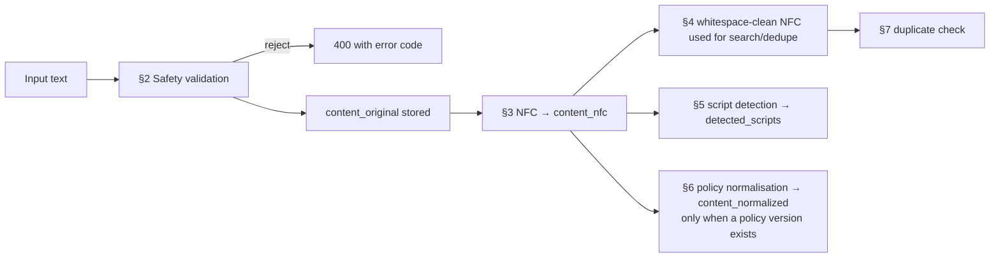

# Text Processing Pipeline

Status: **Proposed.** Applies to standalone Mundari text, transcriptions, and translations.

Implementation status (Milestone 4): §2 safety checks, §3 NFC, §5 script detection, and the §8 uncertainty flag are pure functions in `backend/app/text/`, applied when a revision is saved. The exact duplicate check of §10 runs in the `text.derive` job; near duplicates (`pg_trgm`) come with the review screens (M6); §6 waits for a policy (Q-X2).

## 0. Principles

1. **Store what the person wrote.** `content_original` is the submitted text, byte-for-byte, after only the safety rejections in §2 (ADR-010). We do not "fix" spelling on input.
2. **There is no single correct Mundari spelling.** Mundari is written in Devanagari, Latin, and Nag Mundari (Mundari Bani) scripts, and possibly others regionally, with variation between communities and writers. Lokdhara records the script and variety; it does not enforce an orthography.
3. **Derived forms are separate and versioned.** Any normalisation is stored alongside, never instead of, the original.
4. **Every change is a new revision** with provenance (ADR-011).

## 1. Pipeline overview

## 2. Safety validation (reject, do not alter)

| Check | Rule | Error code |
|-------|------|-----------|
| Encoding | Must be valid UTF-8 | `invalid_encoding` |
| Length | Word/phrase ≤ 200 chars; sentence ≤ 1,000; paragraph ≤ 5,000; long text ≤ 50,000 (initial values) | `text_too_long` |
| Empty | Not empty after trimming whitespace | `text_empty` |
| Control characters | Reject C0/C1 controls except TAB (U+0009), LF (U+000A), CR (U+000D) | `disallowed_character` |
| Bidirectional overrides | Reject U+202A–U+202E, U+2066–U+2069 (prevent "Trojan Source"-style spoofing in reviewer UI) | `disallowed_character` |
| Noncharacters / unassigned / private use | Reject unassigned code points and private-use areas (unless a linguist approves a PUA convention) | `disallowed_character` |
| Allowed joiners | **Keep** ZWJ (U+200D) and ZWNJ (U+200C) — they change rendering in Devanagari and other Indic scripts | — |
| Markup | Text is plain text; HTML is never interpreted. The UI renders text as text (React escapes by default; no `dangerouslySetInnerHTML`). | — |

The Python runtime's Unicode database version must include Nag Mundari (Unicode 15.0+); Python 3.13 ships Unicode 15.1 (verified during planning).

## 3. Unicode normalisation (`content_nfc`)

- Apply **NFC** (`unicodedata.normalize("NFC", s)`). NFC is canonical-equivalence-preserving: it changes code points, not meaning, so the rendered text is identical.
- **Do not** apply NFKC/NFKD (compatibility normalisation) — it can change characters' identity (e.g., superscripts, ligatures, some letterlike forms).
- Line endings normalised to LF in `content_nfc` only.

## 4. Whitespace cleanup (derived, for search and dedupe only)

In a search key (not stored as a revision field): collapse runs of spaces/tabs to one space, trim ends, normalise non-breaking space (U+00A0) to space. Newlines are preserved in `content_nfc` because line structure matters for songs and poems.

## 5. Script and language metadata

- **User-declared** `script_code` and `language_tag` are stored on the text layer.
- **Detected** scripts: for each character with a script property, count by script (`regex` library `\p{Script=…}`); store the set in `detected_scripts`.
- If declared and detected disagree (e.g., declared `Deva`, detected `Latn`), show a warning to the contributor and a flag to the reviewer — **do not auto-correct**.
- Mixed-script text (e.g., Mundari in Devanagari with English loanwords in Latin) is normal; `Zyyy` is used only when no dominant script applies.
- Language identification by model is **not** used in MVP (no reliable Mundari LID is assumed).

As built (M4, `app/text/scripts.py`):

- Detection runs when a revision is saved, not in the worker, because revisions are append-only and `detected_scripts` could not be filled in later.
- Letters are counted with the `regex` package's Unicode script property. Digits, punctuation, spaces, ZWJ/ZWNJ, and combining marks shared by several scripts (Unicode scripts Common and Inherited) are not counted. Devanagari digits do count as Devanagari.
- Markup tags such as `[inaudible]` are ignored, but the words inside `[?…]` and `[hi: …]` are counted.
- `detected_scripts` lists the most used script first. Letters in any script other than `Deva`, `Latn`, `Nagm`, `Beng`, or `Orya` are counted as `Zyyy`.
- A layer shows `script_mismatch` when its declared script does not appear in its current text at all. A declared `Zyyy`, or text with no letters, never counts as a mismatch. The contributor app applies the same rule while the text is typed (`frontend/src/text/scripts.ts`), so the warning appears before sending; it never blocks or changes the text.

## 6. Policy normalisation (`content_normalized`) — deferred

A normalisation policy (e.g., mapping common variant spellings, nukta usage, or Latin diacritic conventions) can only be written by linguists with community input (Q-X2). When one exists:

- It is a versioned document `docs/normalization/policy-vN.md` plus a pure function `normalize_v1(text) -> text` with exhaustive tests.
- `content_normalized` and `normalization_policy_version` are filled for new revisions and backfilled by a re-runnable job.
- Policies may be **script-specific**; no transliteration between scripts is performed unless a separate, versioned transliteration scheme is approved, and its output is stored as a separate `text_layer` (`layer_type = standalone`, `origin = machine` or `imported`), never as a replacement.

## 7. Linking transcriptions and translations

| Layer | Required link | Example |
|-------|---------------|---------|
| Transcription | `recording_id` | Mundari transcript of recording R1 |
| Translation | `source_layer_id` → the transcription or standalone text it translates | Hindi translation of transcript T1 |
| Standalone text | none | A vocabulary item typed by a contributor |

Translations reference the **layer**, and the dataset release records the exact revision of both source and translation, so a translation can be flagged *stale* when its source layer gets a newer revision (each translation revision stores `source_revision_id`).

## 8. Uncertainty and annotation conventions

Until linguists define conventions (Q-X3), the proposed minimal markup is:

| Markup | Meaning |
|--------|---------|
| `[?word]` | Transcriber unsure of this word |
| `[inaudible]` | Could not be heard |
| `[overlap]` | Overlapping speech |
| `[hi: …]` | Code-switched segment in Hindi |
| `[laugh]`, `[cough]`, `[noise]` | Non-speech events |

`uncertainty_markup = true` when any `[?…]` or `[inaudible]` is present. A revision with uncertainty markup cannot be marked `verified` until resolved or explicitly accepted by a reviewer. The markup format is versioned and parsed by a tested function so exports can strip or convert it.

## 9. Human correction (no review)

There is no reviewer ([ADR-021](ARCHITECTURE_DECISIONS.md#adr-021--no-human-reviewer-accept-after-automatic-checks-keep-text-unverified)), so the contributor corrects their own text. As built (M5):

- The owner can add a revision, or a missing transcription or Hindi/English translation, while the submission is a draft and again once it is `accepted` (not while it is being checked, and never after withdrawal). Each save is a new revision with `origin = human_contributor` and `based_on_revision_id`; a save based on an older revision gets `409 revision_conflict`, and the app reloads and asks the contributor to save again.
- A change after acceptance queues `text.derive` again, so script and duplicate checks see the new text; the submission stays `accepted`.
- Every revision stays `unverified`. Nothing in the app marks text verified; the submission page labels each text "written by the contributor, not checked by anyone".
- The submission page (`/submissions/:id`) shows each text with its translations, a script-mismatch warning, a "the text this translates has changed" warning, and the earlier versions. `GET /text-revisions/{a}/diff/{b}` (`app/text/diff.py`) compares two versions by grapheme cluster (important for matras), and the page shows added text underlined and removed text struck out.

## 10. Duplicate detection (text)

- Exact: same `content_nfc` (whitespace-cleaned) for the same language and layer type → `possible_duplicate` flag.
- As built (M4, `text.derive`): only **standalone** text is compared, in the same language, using the current revision's `content_nfc` with runs of spaces, tabs, and no-break spaces collapsed and the ends trimmed (`normalize.search_key`, computed the same way in SQL). Transcriptions and translations are left out: read-speech transcriptions of one prompt, and translations of short phrases, are expected to match. Matches against other submitted (not draft or withdrawn) submissions are linked in `related_items` as `possible_duplicate`, at most 50 per run. Nothing is merged or hidden.
- Near: trigram similarity (`pg_trgm`, threshold tuned in pilot) shown to reviewers as "similar entries". Common for vocabulary items; duplicates of a *word* from different speakers are **valuable variation**, so near-duplicates are informational only.

## 11. Version tracking

Covered by `text_revisions` (append-only); the app lists a text's versions newest first. The *current* revision pointer moves forward only; reverting creates a new revision whose content equals an older one, keeping history linear and auditable.
