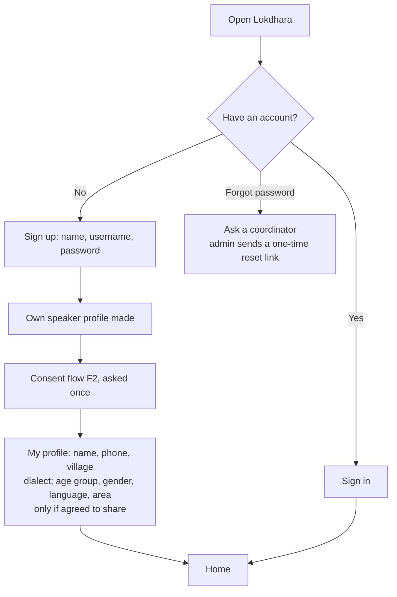
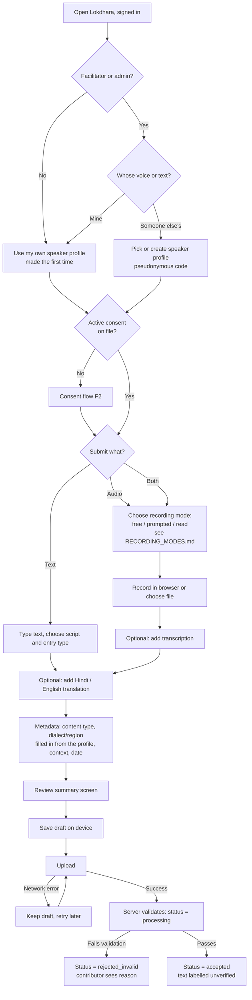
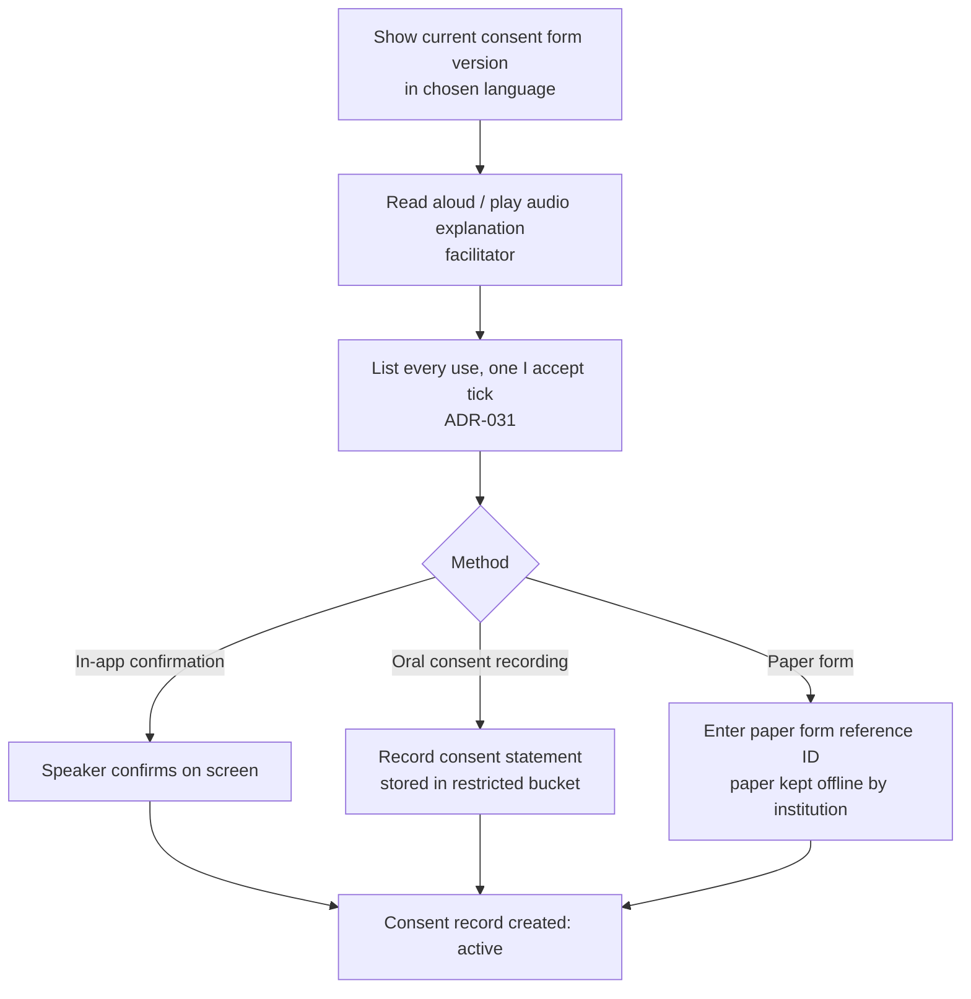
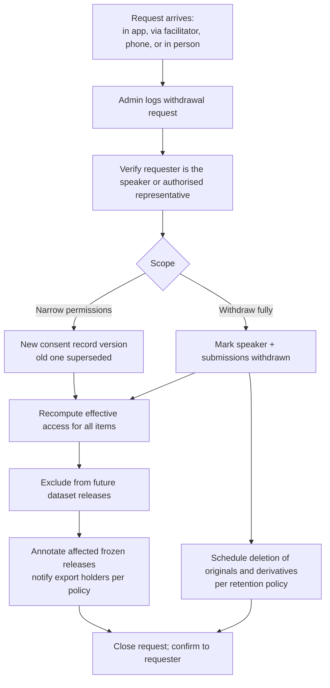
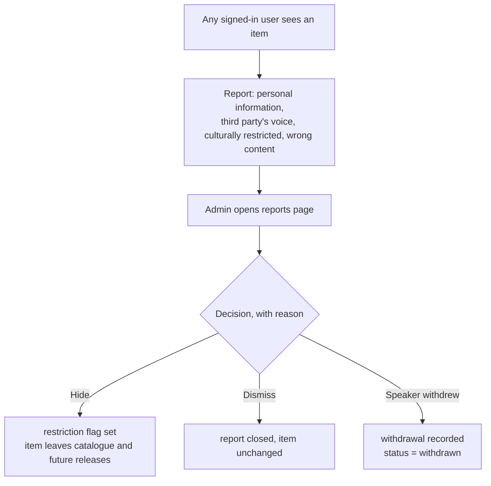
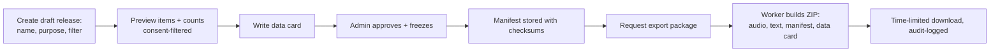

# User Flows

Status: **Draft** · Describes MVP flows at the level needed for API and UI design. Screen designs come in Milestone 3.

## F0 — Sign up and profile (ADR-028)

- Sign-up makes a **contributor**. Facilitators, reviewers, researchers and admins join by an invitation link an admin makes on **People and accounts**.
- The profile is asked once and can be changed from **My profile**. New recordings start with its dialect and area filled in.
- At most 20 accounts per network per hour, to slow down spam.

## F1 — Contribution (main flow)

Notes:

1. Steps 1–8 of the brief map to: open (A), choose type (G), content + metadata (H–L), consent (E/F), validation and storage (O–Q), reports and hiding (F4), authorised access (F5), export (F6).
2. Consent is checked *before* content entry so that a speaker who declines is not recorded first and asked later. A facilitator may still capture consent at the end of a session if that matches field practice; in that case the draft cannot be uploaded until consent is attached. Which order is used in the field is open question Q-G4.
3. The draft is saved on the device before any upload starts (FR-S6).
4. Only facilitators and admins are asked "whose voice or text is this?", because recording other people is their job (owner's decision 2026-10-29, Q-G12, ADR-032). Contributors always record their own voice or text.

## F2 — Consent capture

- The "I accept" tick starts empty and agrees to every use at once (ADR-031); there is no age or guardian question (ADR-032).
- The consent record stores the form version, answers, method, who obtained it, and when.

## F3 — Withdrawal or change of consent

As built (M7 part 2): a contributor asks from an item's page or from *Take recordings back*; an admin logs other requests on *Withdrawal requests*. Accepting (step C) hides and deletes at once (ADR-022). For narrowing, the new consent is recorded on the consent page first. Affected frozen releases show their withdrawn-item count and offer *Start the replacement release* (a PATCH release). Notifying export holders waits for Q-G5.

## F4 — Reports and hiding

There is no reviewer ([ADR-021](ARCHITECTURE_DECISIONS.md#adr-021--no-human-reviewer-accept-after-automatic-checks-keep-text-unverified)); a submission is `accepted` once its automatic checks pass. People clean up afterwards when something is wrong:

Every decision is audit-logged. A contributor whose item was hidden sees that it was hidden and why, in general terms.

## F5 — Researcher search

1. Researcher signs in and opens *Catalogue*. Every transcription and translation is shown as *contributor-provided, unverified*.
2. Search words in the title or text; filters for kind and content type (the API also takes recording mode and dialect). Each item shows its length, dialect, a text preview, and audio notes (quality flags). More filters (script, has translation, duration range) can follow when researchers ask for them.
3. Results show only items where the researcher's access scope **and** the item's effective consent allow viewing.
4. Playing audio fetches a short-lived signed URL for the *playback* rendition; originals are not available to researchers in the MVP.
5. A researcher who finds a problem uses *Report a problem* on the item, like anyone else (F4).

## F6 — Dataset release and export

## F7 — Administrator: failed processing

1. Admin opens *Processing jobs*, filters `failed`/`dead`.
2. Sees error, attempts, tool versions, linked submission (no audio auto-played).
3. Fixes cause (e.g., deploys a fix) and re-queues; or marks the submission `rejected_invalid` with a reason visible to the contributor.
